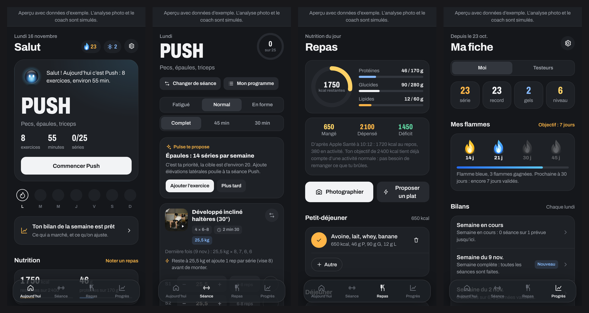
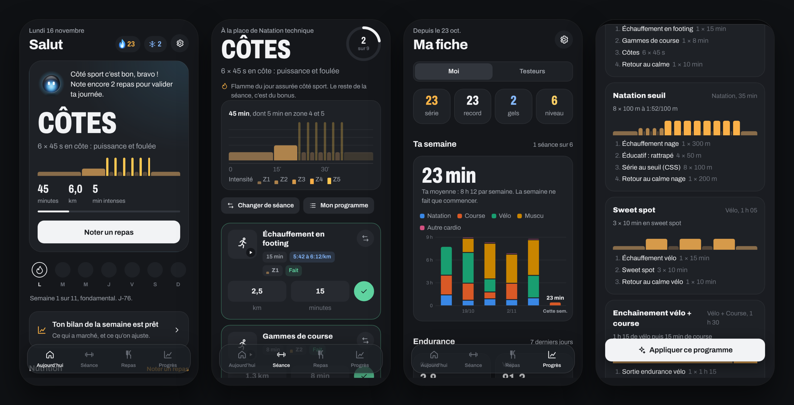

# Shred

[](https://github.com/Selimcc/Shred/actions/workflows/ci.yml)
[](LICENSE)

A training and nutrition companion that installs on the phone like a native app: today's workout with load tracking, meals logged in one tap or from a photo, a Duolingo-style daily streak, push reminders and an AI coach that knows your program.

**[Try the live demo](https://selimcc.github.io/Shred/)**: sample data, simulated AI. Open it on a phone for the real feel. The interface is in French.





## Highlights

- **Local-first PWA.** Everything runs on the phone and works offline at the gym. The network is only needed for the AI and the reminders. No App Store, no Play Store.
- **End-to-end encrypted backup.** The password never leaves the device: PBKDF2-SHA256 (600k iterations) then HKDF derive a login key and a data key. The server stores a salted HMAC of the login key and an AES-GCM blob it cannot read. When two devices diverge, the backups are merged day by day (sets, meals, habits, weigh-ins, health) instead of one overwriting the other.
- **Web Push written from scratch.** VAPID signing and `aes128gcm` payload encryption on WebCrypto, with no dependency, tested against the reference implementation. A Cloudflare cron checks every 15 minutes and stays silent once the day is complete.
- **AI coach with local retrieval.** The history is split into documents (days, weeks, per-exercise history, weight, profile) and indexed on the phone with BM25, recency and gym synonyms. Only the relevant snippets go to the model, which keeps answers grounded and token costs low.
- **Program generator.** Splits built from the target physique, priorities, available days, session length and the equipment of your gym, with weekly volume per muscle and a preview before applying.
- **Endurance plans.** Running, swimming, cycling and triathlon (sprint to Ironman), dated to race day or as renewable 8-week blocks: every week has its own sessions, intensities from your own paces, CSS or FTP, recovery weeks and a taper.
- **One-command deploy** to Cloudflare's free tier, about 20 active users before needing the $5 plan.
- **349 test assertions** (encryption, reminders over simulated days, auth, retrieval, streak rules, generator, endurance plans, backup merge, deload, health parsing) plus strict TypeScript on both front and back.
- **Continuous deployment.** Every push is type-checked, tested and built; a green push to `main` is deployed to Cloudflare and smoke-tested.

## Features

| | |
| --- | --- |
| **Workout** | Today's session, sets with load and reps, suggested next load, swap/skip/add exercises (broken machines are swapped for a week), 30 or 45 min express mode, rest-timer notification on a locked phone (Durable Object alarm), automatic deload week every 6 to 8 weeks, ~110 exercises with demos |
| **Endurance** | Easy, long, progressive and recovery runs, intervals, hills, fartlek and tempo; swim drills (catch-up, fist, side kick, sculling), kick and pull sets, CSS threshold sets, sprints, open water; endurance, long, sweet spot, threshold, VO2 max, cadence and force rides; bike-to-run bricks and transitions; sport-specific strength (runner, swimmer, cyclist, triathlete). Each session shows an intensity profile (zones 1 to 5) that lights up as you go; distance and time are logged per block |
| **Nutrition** | Calorie and macro targets (Mifflin-St Jeor), barcode scanner (Open Food Facts, native BarcodeDetector or ZXing on iPhone), meal photo analysis, weekly meal plan with batch cooking and a shopping list, dish suggestions for the remaining macros |
| **Streak** | Daily goal (half of the session, a started cardio session or 30 min at the gym is enough; rest days only need meals), streak freezes, flame tiers, XP, an original mascot and celebration animations (SVG/CSS, respects reduced motion) |
| **Progress** | Weekly training time stacked by sport with tooltips, distance tiles with 8-week sparklines (rolling 7 days), estimated 1RM curve per lift with records marked, interactive Apple Health cards, weight trend, waist, weekly physique photos compared side by side, strength profile, volume per muscle |
| **Coach** | Chat that knows your program, your day and your history; weekly report with one-tap adjustments; strength profile graded A to E per muscle group |
| **Plans** | 5K, 10K, half, marathon, triathlon (S, M, 70.3, Ironman), 1,500 m and 5 km open-water swims, 100 and 160 km sportives and Hyrox, dated to race day; or an 8-week block that Pulse renews one notch harder |
| **Integrations** | Apple Health through iOS Shortcuts: steps, energy, sleep, resting heart rate, HRV, exercise minutes, distance (sleep and HRV suggest the day's readiness), gym check-ins, weekly report by email (Resend) |
| **Accounts** | Invite-only, multiple users per server, admin page and CLI, opt-in public profiles |

## Architecture

```
Phone (installed PWA)                 Cloudflare Workers (free tier)             Anthropic API
┌────────────────────────┐  HTTPS   ┌──────────────────────────────┐  HTTPS   ┌─────────────┐
│ React + service worker │ ───────► │ /api/*  + static app          │ ───────► │ vision,     │
│ data: localStorage     │ ◄─────── │ KV: accounts, encrypted       │          │ coach       │
│ local BM25 retrieval   │          │     backups, reminders, health│          └─────────────┘
│ photos: IndexedDB      │   push   │ cron every 15 min             │
└────────────────────────┘ ◄─────── └──────────────────────────────┘
```

A single Worker serves the app and the API on the same origin, so there is no CORS. The training program is data (`shared/`), shared by the front and the Worker; the code only interprets it. More detail in [docs/ARCHITECTURE.md](docs/ARCHITECTURE.md).

**Stack:** React 19, TypeScript, Vite, Cloudflare Workers + KV + Cron Triggers, Web Push, WebCrypto, Anthropic API (vision and chat).

## Run it locally

Requires Node 20+.

```bash
npm install
cp .dev.vars.example .dev.vars     # MOCK_AI=1: simulated AI, no API key needed
npm run vapid                      # paste both keys into .dev.vars
npm run build && npm run dev:api   # app + API on http://localhost:8787
```

Create the first account by opening `http://localhost:8787/?invite=<ADMIN_CODE from .dev.vars>`.

For front-end work with hot reload, run `npm run dev:api` and `npm run dev` side by side, then open `http://localhost:5173`.

The demo build (`npm run build:demo`) is a single HTML file with sample data and a fake API, the same one deployed as the live demo.

## Deploy

```bash
npm install
npm run setup
```

The script logs into Cloudflare, creates the KV namespace, asks for the VAPID contact email and the API key, generates the VAPID keys and an admin code, builds and deploys, then prints the URL and a QR code that opens the app with the admin code filled in. It can be re-run safely; secrets are kept in `.shred-secrets.json` (git-ignored).

On iPhone, add the app to the home screen from Safari and open it from the icon before enabling reminders: web push on iOS only works for installed apps (iOS 16.4+).

### Continuous deployment

[`.github/workflows/ci.yml`](.github/workflows/ci.yml) runs on every push and pull request: `npm ci`, typecheck, the test suites, the production and demo builds, and a `wrangler deploy --dry-run` of the Worker. When a push to `main` passes, the `deploy` job uploads the built app with `wrangler deploy` and checks that `/api/version` reports the new version.

It needs two repository secrets (Settings > Secrets and variables > Actions):

| Secret | Where to get it |
| --- | --- |
| `CLOUDFLARE_API_TOKEN` | Cloudflare dashboard > My Profile > API Tokens > Create Token > "Edit Cloudflare Workers" template |
| `CLOUDFLARE_ACCOUNT_ID` | Cloudflare dashboard > Workers & Pages, right column |

Without them the checks still run and the deploy job is skipped with a warning. Worker secrets (`ANTHROPIC_API_KEY`, VAPID keys, `ADMIN_CODE`) stay on Cloudflare and are not needed in GitHub. The pipeline can also be started by hand from the Actions tab (`workflow_dispatch`).

**Cost:** Cloudflare's free tier covers about 20 active users. A meal photo analysis costs under one cent and a coach message a fraction of a cent. `DAILY_AI_LIMIT` and `GUEST_AI_LIMIT` cap AI requests per day.

## Tests

```bash
npm test           # push encryption, VAPID, reminders, health, auth, encrypted backup and merge, retrieval, streak, coaching, generator, deload, rest timer, endurance
npm run typecheck  # front and Worker
```

The reminder tests simulate the cron over several days, send real encrypted notifications to a fake device and check that they decrypt, that there are no duplicates, that nothing is sent once the day is complete and that expired subscriptions are removed.

## Project layout

```
shared/        program model, exercise library, templates, generator, athlete needs, race and endurance plans, effort model, meals
src/screens/   Today, Workout, Food, Coach, Progress, Settings, program editor and builder, onboarding
src/lib/       store and migrations, streak/XP logic, crypto, backup, retrieval, coaching, reports
src/components UI kit, charts, mascot and celebrations
worker/        API routes, auth, Web Push, reminders, AI calls, Apple Health, profiles, email report
scripts/       setup, admin CLI, VAPID key generation, test suites
```

## Credits

Exercise demo images come from [Free Exercise DB](https://github.com/yuhonas/free-exercise-db) (public domain, Unlicense).

## License

[MIT](LICENSE) © 2026 Selim Jabnoun
